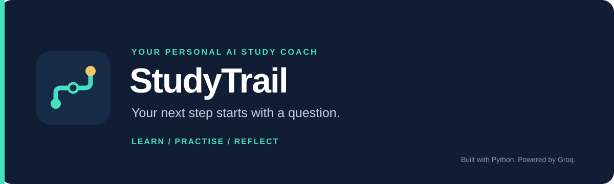
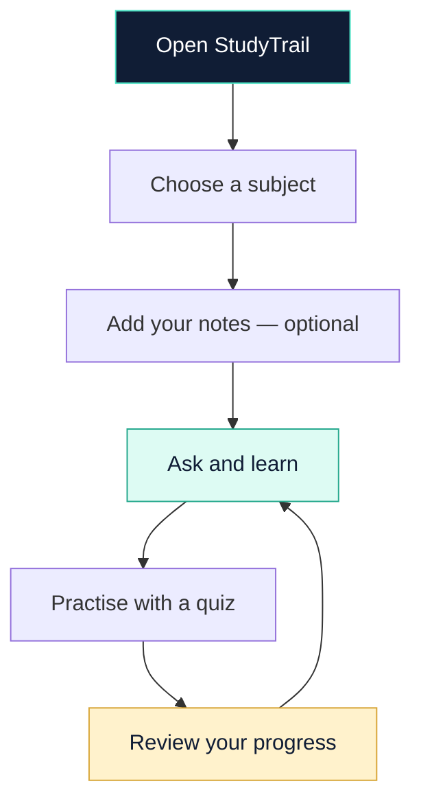

<p align="center">
  
</p>

<p align="center">
  
</p>

<h1 align="center">StudyTrail</h1>

<p align="center">
  <strong>Your notes. Your pace. Your next breakthrough.</strong><br>
  A personal AI study assistant that lives in your terminal.
</p>

<p align="center">
  <a href="#get-started">Get started</a> ·
  <a href="#your-learning-flow">Learning flow</a> ·
  <a href="#contribute">Contribute</a> ·
  <a href="docs/SETUP.md">Setup help</a>
</p>

---

Learn Python, Java, history, or another subject with explanations, quizzes, and
progress you can revisit. Bring your own compatible AI API key, add your notes,
and start a conversation.

- **Study your material** — paste notes or import `.txt` and `.md` files.
- **Practise with purpose** — ask for quizzes and get feedback on your answers.
- **See your progress** — quiz results stay on your computer between sessions.
- **Choose your AI provider** — use OpenAI, Groq, DeepSeek, or a compatible endpoint.
- **Try it offline** — explore the built-in demo without an API key.

## Get started

**1. Install [uv](https://docs.astral.sh/uv/getting-started/installation/)** and
open a new terminal.

**2. Install StudyTrail.** These commands work in Windows PowerShell, macOS, and Linux:

```sh
uv tool install --python 3.12 studytrails
uv tool update-shell
```

**3. Close and reopen your terminal, then start:**

```sh
studytrails
```

That is also the command to use next time, from any folder. No environment
activation needed. Python 3.12 is used here for a consistent setup; uv can download
it when needed. See the [full setup guide](docs/SETUP.md) if you prefer pip or need help.

### Connect your AI

At **Configure AI now?**, type `y` and follow the prompts:

1. **Choose a provider number:** `1` custom endpoint, `2` OpenAI, `3` Groq, or `4` DeepSeek.
2. **Enter the model ID** from that provider. For a custom provider, also enter its API base URL.
3. **Paste your API key** at the hidden key prompt, then choose whether to test the connection.

Your key and model must belong to the selected provider. The model must support
OpenAI-compatible Chat Completions with tool calling. At `[y/n]` prompts, `y`
means yes, `n` means no, and Enter means no.

Want to explore first? Choose `n`, then **Offline demo** from the menu.

> StudyTrail is free and open source. Live AI uses your provider's free allowance
> or paid plan; the optional connection test also uses API quota.

## Your learning flow



### Bring a subject to life

Choose **Manage notes**, give your notes a subject and title, then paste text or
import a `.txt` or `.md` file. Finish pasted notes with `.done` on its own line.
Choose **Start learning** and enter the same subject.

Try one of these:

```text
Explain inheritance using my Java notes, then give me two beginner questions.
Help me practise Python loops with three questions.
Review my scores and suggest what I should practise next.
```

Notes are optional, but clear headings and examples help the agent find useful
passages. Retrieval uses keyword search and returns filename/line references;
it does not train a model. Note files can be up to 200 KB each. PDF, Word, and
image imports are not supported yet.

Matching note passages are sent to your chosen AI provider. Notes and quiz
results are stored locally, and saved API keys use a supported OS credential
store. See the [user guide](docs/USER_GUIDE.md) for storage and configuration details.

## Everyday commands

```sh
studytrails                   # Open the learning menu
studytrails config            # Change your provider, model, or key
studytrails scores            # View saved quiz results
studytrails demo              # Try the offline demo
studytrails --version         # Check your installed version
studytrails --help            # Explore all commands
```

Inside chat, use `/scores`, `/pending`, and `/quit`. During quizzes, choose
**A–D** to answer or **Q** to leave without submitting. The offline demo uses
fixed questions and keeps its progress separate from live learning.

To update an installation made with the commands above:

```sh
uv tool upgrade studytrails
```

## How the agent works

The AI can search your notes, read saved scores, and create quizzes through three
tools. Python validates the tool inputs and grades submitted answers; SQLite
stores the results. The agent cannot run generated code. AI explanations and
quiz answers can still be wrong, so check important details against your sources.

**Built with:** Python · OpenAI Python SDK · Pydantic · SQLite · Rich · uv

## Contribute

**You do not need to be an AI expert to help.** First-time contributors are welcome.

- Found a bug? [Open an issue](https://github.com/heyyash-input/StudyTrails/issues/new) with steps to reproduce it.
- Enjoy writing? Improve an explanation, setup instruction, or example.
- Have useful study notes? Share material you wrote or have permission to distribute.
- Want to code? Propose a focused fix or discuss a larger feature in an issue first.

**Fork → create a branch → make your change → open a pull request.**

Read [CONTRIBUTING.md](CONTRIBUTING.md) for local setup and contribution checks.
Keep API keys, private notes, and personal databases out of issues and pull requests.

---

Created by **[Yash Patil](https://github.com/heyyash-input)**, a Python and AI learner.
Built using **OpenAI's Python SDK** for compatible chat APIs. OpenAI created the
GPT-OSS model family; your selected provider hosts the model you choose.

**[MIT licence](LICENSE)** · [Setup guide](docs/SETUP.md) ·
[User guide](docs/USER_GUIDE.md) · [Release guide](docs/RELEASING.md)
